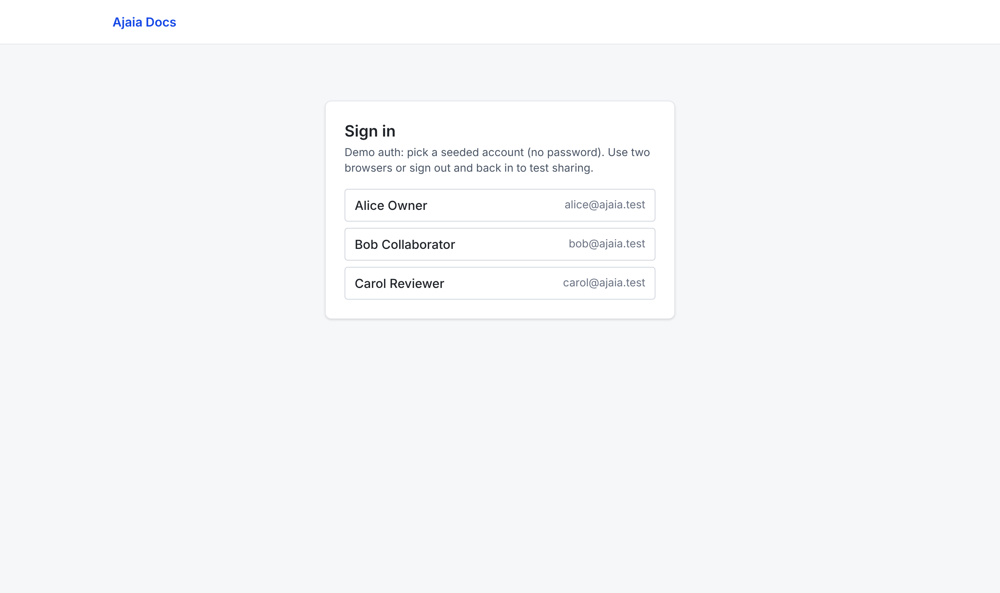
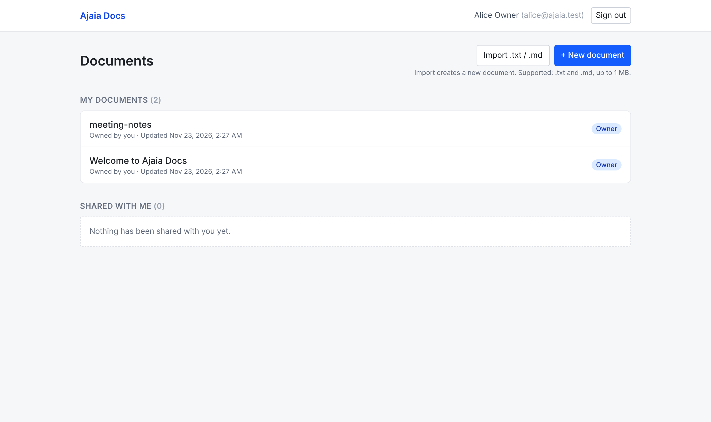
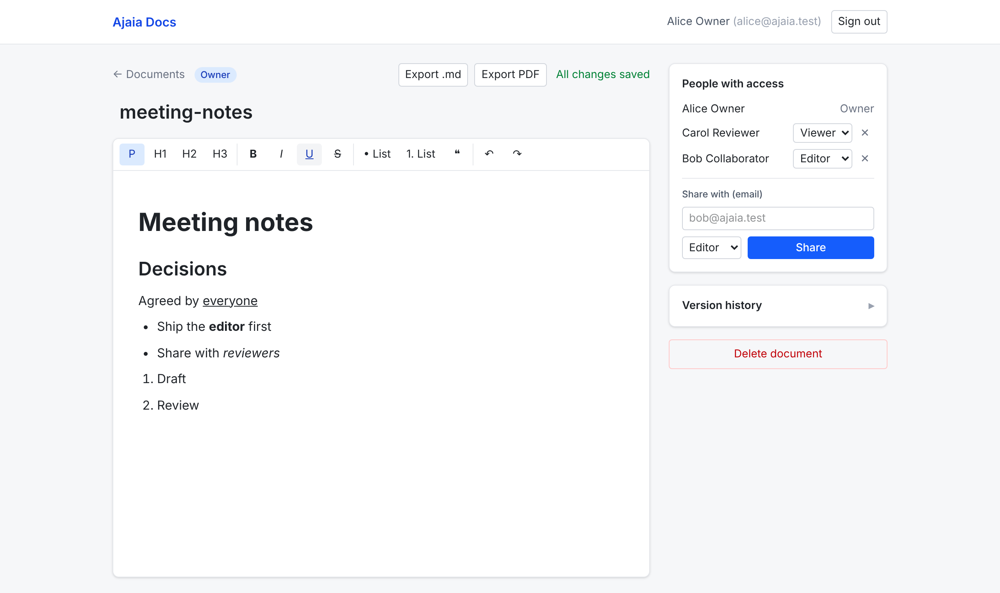
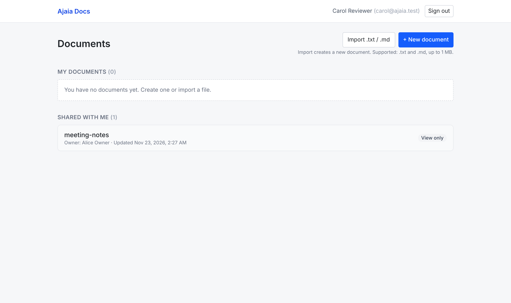
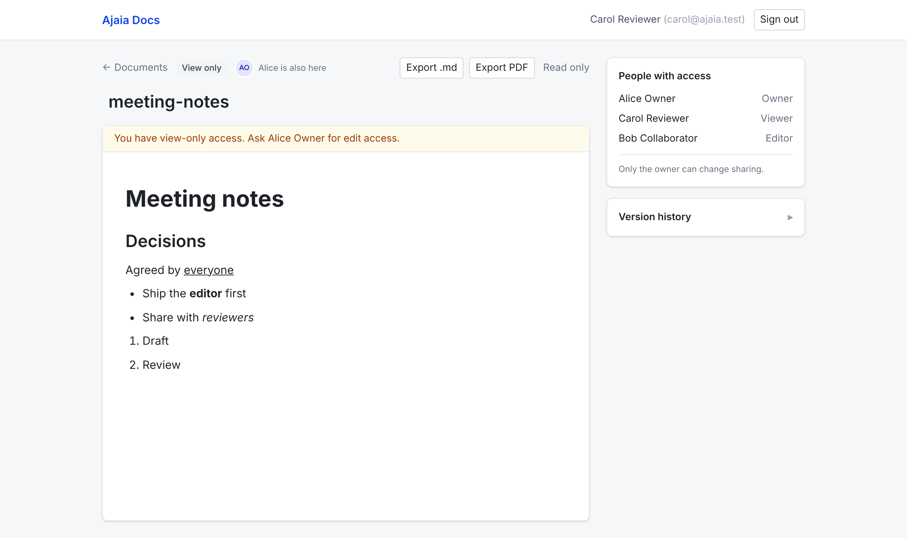
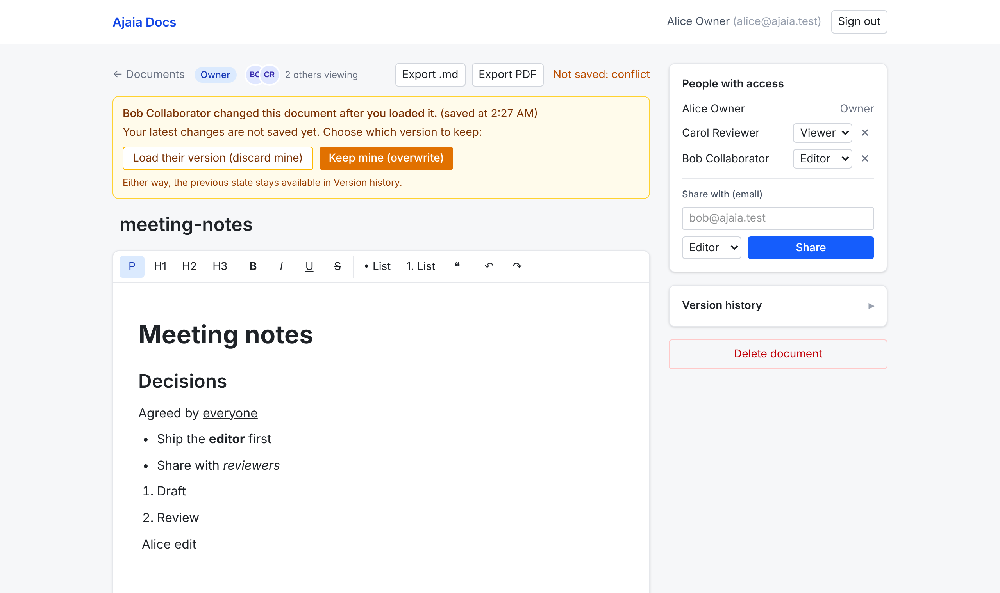
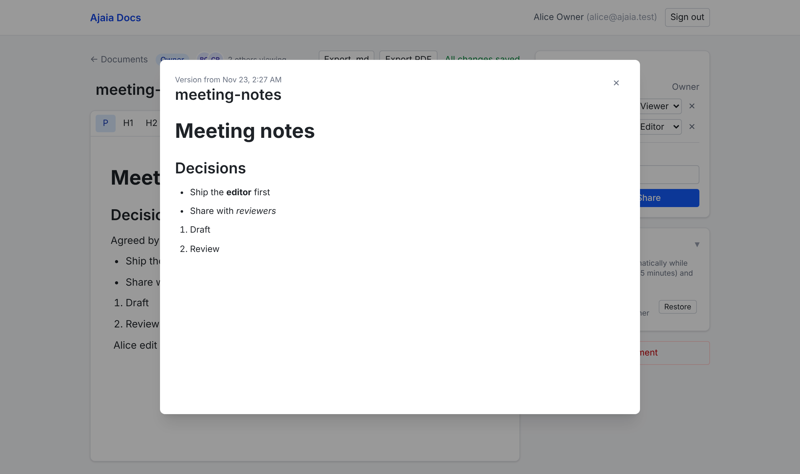

# Ajaia Docs

A lightweight collaborative document editor inspired by Google Docs, built for the Ajaia LLC Full Stack Product Engineer assignment.

**Live demo:** https://ajaia-docs-one-mauve.vercel.app

## Features

- **Documents:** create, rename, edit, delete. Rich text with bold, italic, underline, strikethrough, headings (H1 to H3), bulleted and numbered lists, quotes, undo/redo.
- **Autosave:** changes are saved automatically after a short pause, with a visible status ("Unsaved changes", "Saving...", "All changes saved", or an error with Retry). The browser warns before leaving with unsaved changes.
- **File import:** upload a `.txt` or `.md` file (max 1 MB) from the dashboard and it becomes a new editable document. Markdown formatting (headings, bold, lists, etc.) is preserved. Other file types are rejected with a clear message.
- **Sharing:** the owner shares a document by email as **Editor** or **Viewer**, changes roles, or revokes access. The dashboard separates **My documents** from **Shared with me**, with an access badge on each item.
- **Export:** anyone with access can download the document as Markdown (`.md`) or save it as PDF through the browser's print dialog (a print stylesheet hides the app chrome).
- **Save conflict detection:** every save carries the version it was based on. If someone else saved first, nothing is overwritten: a banner names who changed it and lets you load their version or keep yours.
- **Version history:** snapshots are kept automatically (at most one every 5 minutes while editing, plus before each restore). Browse, preview and restore from the side panel; restores are themselves undoable.
- **Who's viewing:** avatars show other people currently on the same document (polling every 10 s).
- **Persistence:** Postgres via Prisma. Content is stored as HTML generated by the editor, so formatting survives reloads.

## Demo accounts

Authentication is mocked: pick an account on the sign-in screen (no password).

| User | Email | Seed data |
| --- | --- | --- |
| Alice Owner | alice@ajaia.test | Owns "Welcome to Ajaia Docs" |
| Bob Collaborator | bob@ajaia.test | Has Editor access to Alice's welcome doc |
| Carol Reviewer | carol@ajaia.test | No documents; share something with her to test Viewer access |

To test sharing, use two browsers (or a normal and a private window) signed in as different users, or sign out and back in.

## Run locally

Requirements: Node.js 20+ and a Postgres database (local install, Docker, or a free Neon database).

```bash
# 1. Start Postgres (example with Docker)
docker run -d --name ajaia-pg -e POSTGRES_PASSWORD=postgres -e POSTGRES_DB=ajaia -p 5432:5432 postgres:16

# 2. Configure environment
cp .env.example .env        # edit values if your database differs

# 3. Install, migrate and seed
npm install
npx prisma migrate deploy
npm run db:seed

# 4. Run
npm run dev                 # http://localhost:3000
```

## Screenshots

| | |
| --- | --- |
|  Mock login with demo accounts |  Owned vs shared lists, import |
|  Editor, toolbar, sharing panel |  Carol's "Shared with me" |
|  Viewer: read-only, presence |  Save conflict banner |
|  Version history preview | |

## Tests

```bash
npm test
```

Covers the access policy (owner / editor / viewer / no access), the document service sharing flow (owned vs shared lists, view-only enforcement, revoking access, 404 instead of 403 for non-shared docs, invalid share targets) the file import conversion (escaping, markdown, validation) the Markdown export (every toolbar format, round-trip through the importer, safe file names), save conflicts and version history (injected clock: 409 on stale saves, snapshot throttling, restore and undo, access rules) presence (active window, stale viewers, no-access 404), regression tests for every bug found in the manual QA pass on production (`docs/qa/`), and the SOLID audit fixes (a save that loses a race rolls back its snapshot, restore is atomic, error body shape, generic share message). The service tests run against an in-memory repository, so no database is needed.

## Deploy (Vercel + Neon)

1. Create a Neon Postgres database (free tier). Copy the pooled and direct connection strings.
2. Import this repo in Vercel. Set env vars: `DATABASE_URL` (pooled), `DATABASE_URL_UNPOOLED` (direct) and `AUTH_SECRET` (long random string). The Neon integration in the Vercel marketplace sets the database vars automatically.
3. Deploy. The `vercel-build` script runs migrations and the idempotent seed before `next build`.

## CI

GitHub Actions (`.github/workflows/ci.yml`) runs on every push and PR: ESLint, typecheck, unit tests, migrations from scratch against Postgres 16 plus the seed twice (idempotency), and a production build. Every feature after the first deploy was merged through a PR gated on this check: [#1](https://github.com/LeonOmega2712/Ajaia-LLC-Full-Stack-Product-Engineer-Test/pull/1) CI, [#2](https://github.com/LeonOmega2712/Ajaia-LLC-Full-Stack-Product-Engineer-Test/pull/2) conflicts + history, [#3](https://github.com/LeonOmega2712/Ajaia-LLC-Full-Stack-Product-Engineer-Test/pull/3) presence, [#4](https://github.com/LeonOmega2712/Ajaia-LLC-Full-Stack-Product-Engineer-Test/pull/4) docs and screenshots.

## Project structure

```
prisma/                 schema, migrations, seed
src/app/                pages (dashboard, login, editor) and API route handlers
src/components/         UI (editor, toolbar, share panel, lists)
src/lib/access/         pure access-control policy
src/lib/documents/      service (use cases), repository port + Prisma adapter, validation
src/lib/import/         .txt/.md to HTML conversion
src/lib/export/         HTML to Markdown conversion
src/lib/presence/       who-is-viewing service, port and Prisma adapter
src/lib/auth/           mocked session (signed cookie)
tests/                  Vitest suites
```

See [ARCHITECTURE.md](./ARCHITECTURE.md) for decisions and tradeoffs and [AI_WORKFLOW.md](./AI_WORKFLOW.md) for how AI tools were used.
